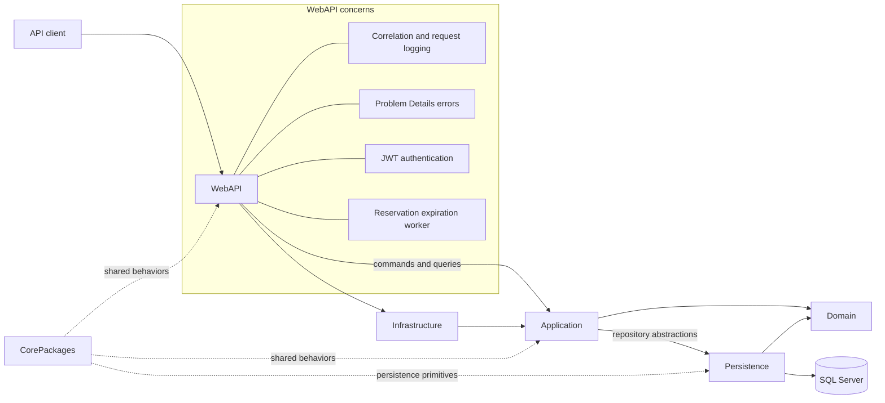
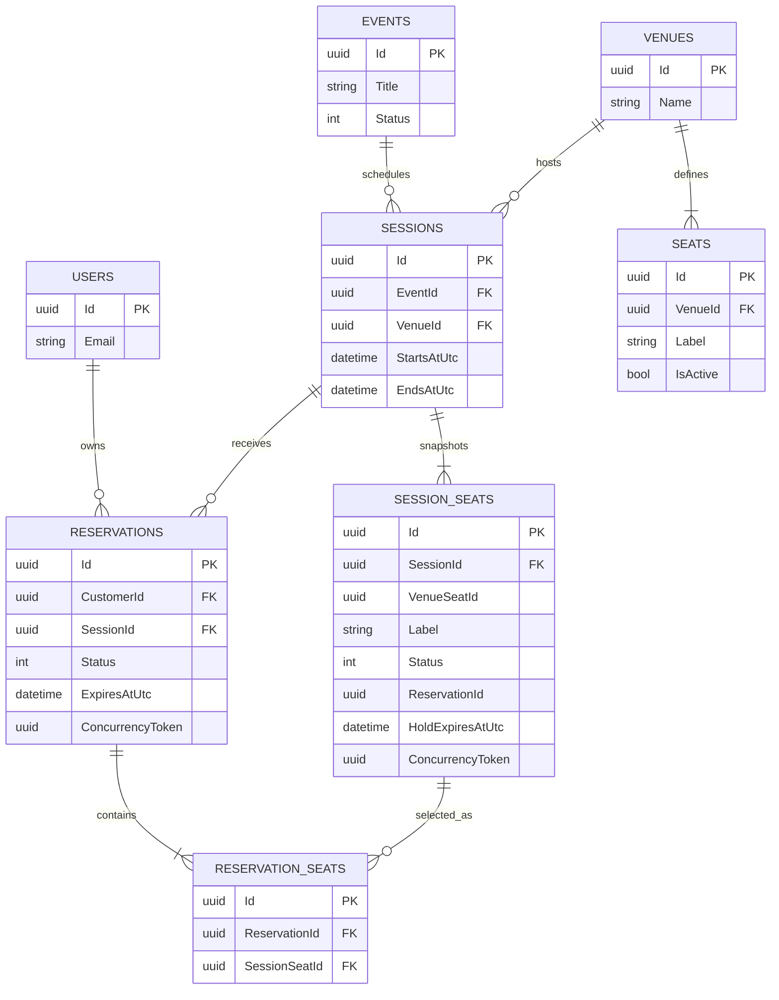

# Architecture and Data Model

The application uses Clean Architecture boundaries: dependencies point toward
the domain, while the Web API composes the application and infrastructure at
runtime.

The HTTP layer never accepts the customer identity for a reservation from the
request body. It takes the identity from the authenticated token, sends a
command or query through MediatR, and lets the domain enforce state changes.

## Reservation Data Model

This diagram focuses on the original event-reservation tables. Authentication
support tables are intentionally omitted except for `Users`.

`SessionSeat` is a snapshot of the venue layout when the session is created, so
later venue edits cannot rewrite an already scheduled event. Concurrency tokens
on mutable seat and reservation state make competing holds detectable. The
reservation and all affected seats are written in one transaction, preventing
partial multi-seat holds.

## Operational Boundaries

- `X-Correlation-ID` is accepted when safe, otherwise generated, returned to the
  caller, added to the logging scope, and included as `traceId` in error bodies.
- `/health/live` reports whether the process is running.
- `/health/ready` also verifies database connectivity.
- The expiration hosted service uses the same domain transitions as foreground
  requests; repeated expiration and confirmation operations are idempotent.
